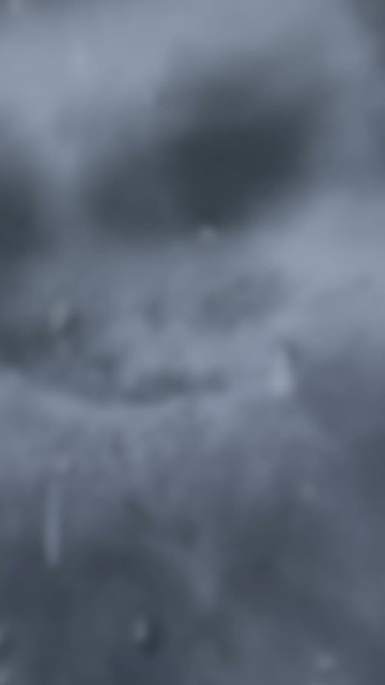
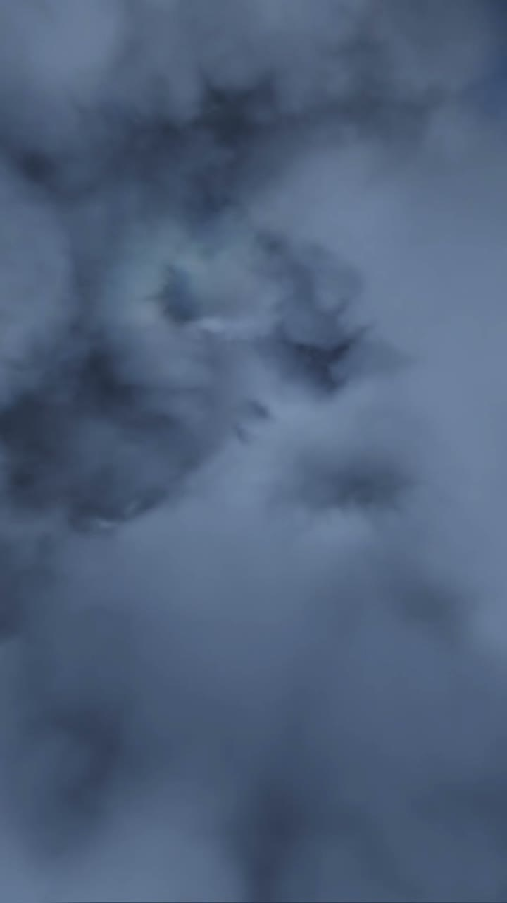
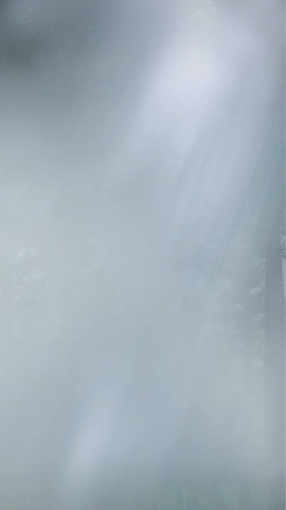
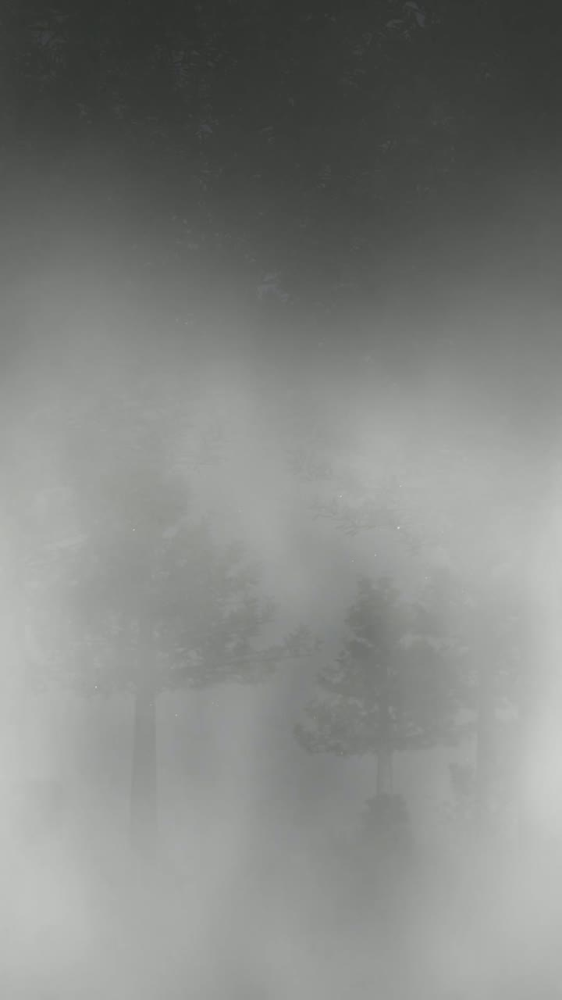
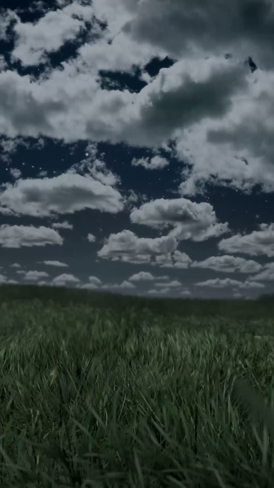
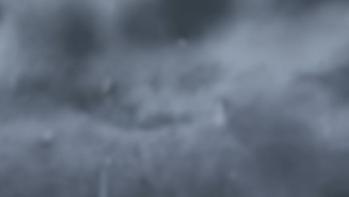
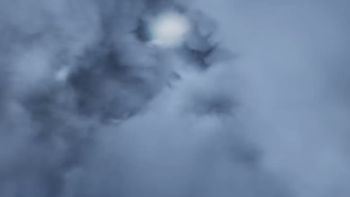

# Sky video previews

Still frames (2 s into each loop) from the **`com.htc.htcweatherassets`** MP4s used by the live wallpaper.  
Videos are **not** included in this repo; install the [video companion](../README.md#video-companion) on your phone to play them.

## Portrait (`weather_*`) — typical phone wallpaper

| | | |
|:---:|:---:|:---:|
|  |  |  |
| sunny | clear | partly_sunny |
|  |  |  |
| partly_cloud_day | partly_cloud_night | cloudy_day |
|  |  |  |
| cloudy_night | rain_day | rain_night |
|  |  |  |
| thunderstorm_day | thunderstorm_night | snow_day |
|  |  |  |
| snow_night | fog_day | fog_night |
|  |  |  |
| windy_day | windy_night | hot |

## Landscape (`weather_l_*`) — wider surfaces

| | | |
|:---:|:---:|:---:|
|  |  |  |
|  |  |  |

Full set: see [`landscape/`](./landscape/) (18 files).

## Regenerate

From a machine with the HTC video companion APK and FFmpeg:

```powershell
.\scripts\capture-sky-frames.ps1
```
